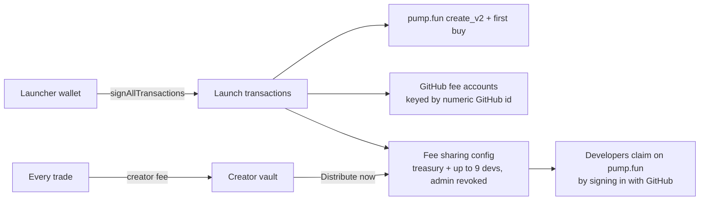

<p align="center"></p>

# Splitdev

**Launch a pump.fun coin whose creator fees are split, permanently, between GitHub developers.**

[](https://github.com/furkan3152/ponsplit/actions/workflows/splidev.yml)
[](LICENSE)

Splitdev is a launchpad on [pump.fun](https://pump.fun) (Solana). When you launch a coin you pick up to
nine GitHub accounts and their shares. Every trade of the coin pays pump.fun's creator fee, and Splitdev
routes that fee to those developers through pump.fun's own on-chain fee sharing, locked so that nobody,
not even the launcher, can change it later. Developers claim on pump.fun by signing in with GitHub, so
they need no wallet in advance and Splitdev never holds anyone's money.

**Live:** [splitdev.app](https://splitdev.app) (Solana mainnet)

> Splitdev is an independent project and is not affiliated with pump.fun or GitHub.

## Features

- **One-prompt launch.** `create_v2` plus an optional first buy, the GitHub fee accounts that don't exist
  yet, the fee-sharing config with admin revoked, and the launch fee are built client-side and signed
  together with `signAllTransactions`.
- **Interrupted launches recover.** If the coin lands but the fee split doesn't, the pending launch is
  saved per wallet and mint, re-checked against the chain, and offered as "Finish launch".
- **Trading on the curve and the pool.** Buy and sell on the bonding curve and, after graduation, on
  PumpSwap. Quotes include virtual pool reserves, and a trade aborts if the price moved past slippage.
- **Permissionless fee distribution.** A "Distribute now" button sweeps the creator vault (and the pool
  side for graduated coins) to the shareholders.
- **Claim lookup.** `/claim` shows what any GitHub username has waiting and from which coins.
- **Spoof-resistant listing.** Only coins with Splitdev's exact on-chain shape are listed: final and
  active split, treasury first at the allowed share, every other shareholder a pump.fun GitHub fee
  account. Trades are read only from events emitted by the pump.fun programs.
- **Charts and live data.** Candles built from on-chain trade events, rendered with lightweight-charts.
- **Hardened server.** Per-IP rate limits, a budgeted GitHub API client with caching, image uploads
  validated from their bytes, DNS-rebinding-safe metadata fetches, strict security headers.

## How it works



There is no Splitdev smart contract: a Splitdev coin is a normal pump.fun coin. Discovery is a single
filtered `getProgramAccounts` call on pump.fun's fee program (SharingConfig discriminator + treasury at
offset 80), which lists every Splitdev coin without an indexer or database.

Fees (pump.fun mainnet, October 2026): the bonding curve charges 1.25 %, of which 0.30 % is the creator
fee. Splitdev keeps `platformBps` of the creator fee (10 % today) and charges a 0.01 SOL launch fee; the
rest goes to the GitHub accounts by their shares. Settings live in [`src/splidev.json`](src/splidev.json)
and are validated at build time by `next.config.mjs`.

## Tech stack

- **App:** Next.js 15 (App Router), React 18, TypeScript, Tailwind CSS, TanStack Query
- **Solana:** `@solana/web3.js`, Solana wallet adapter, `@pump-fun/pump-sdk` v2, `@pump-fun/pump-swap-sdk`, SPL Token
- **Data:** GitHub REST API, Vercel Blob (coin images and metadata), optional Pinata/IPFS
- **Testing:** Node test runner (unit), `solana-test-validator` with pump.fun's real programs dumped from
  mainnet (integration), Playwright (browser end-to-end)
- **Hosting/CI:** Vercel, GitHub Actions

## Project structure

```
src/
  app/                 pages (/, /explore, /create, /token/[address], /claim, /me, /how, /docs)
    api/               coin, snapshot, trades, github/resolve, metadata, upload
  components/          UI, charts, trade panel, "Bitbug" mascot art
  lib/
    solana/            pump.ts (transaction builders), reads.ts (discovery), trades.ts (event parser),
                       server.ts (snapshot and caches), fee math
    github.ts          budgeted, cached GitHub lookups
    ratelimit.ts, ip.ts, image-bytes.ts, metadata.ts   server hardening
  splidev.json         treasury, platform share, launch fee, hidden coins
e2e/
  solana/              local validator, fixtures (pump.fun programs + mainnet accounts), launch/graduate tests
  splidev.mjs          Playwright test of the real UI against the local validator
scripts/               logo renderer, stress test, Vercel ignored-build step
docs/README.tr.md      Turkish operator notes
```

## Getting started

Prerequisites: Node.js 22 and npm. The integration tests also need the
[Solana CLI](https://docs.anza.xyz/cli/install) (Agave 2.3).

```bash
git clone https://github.com/furkan3152/ponsplit.git
cd ponsplit
npm ci
cp .env.example .env.local   # public RPCs work out of the box; see the comments in the file
npm run dev                  # http://localhost:3000
```

Checks:

```bash
npx tsc --noEmit && npm run lint && npm test   # typecheck, lint, 39 unit tests
npm run build
```

Integration tests against pump.fun's real programs on a local validator:

```bash
e2e/solana/validator.sh /tmp/ledger
node e2e/solana/build-lib.mjs
RPC=http://127.0.0.1:8899 node e2e/solana/launch-local.mjs           # launch, list, trade, distribute, claim lookup
RPC=http://127.0.0.1:8899 node e2e/solana/graduate-local.mjs         # graduation and pool trading
RPC=http://127.0.0.1:8899 node e2e/solana/github-fee-compat-local.mjs # current fee vaults, nine recipients
```

CI ([`splidev.yml`](.github/workflows/splidev.yml)) runs these on every push, plus the web checks and a
Chromium test that launches, trades, distributes and checks every page at desktop and phone widths.

## Security

- **Non-custodial.** Users sign in their own wallet; the site has no signing key and never holds funds.
  Fees move only through pump.fun's programs.
- **Immutable splits.** Fee-sharing admin rights are revoked at launch.
- **No secrets in the repo.** `.env*` and keypair files are gitignored; tests use throwaway keypairs on a
  local validator only.
- Trading memecoins is risky; the site shows a risk notice and nothing here is financial advice.

## Status

Live on Solana mainnet at [splitdev.app](https://splitdev.app). The history also contains SplitEarn, the
earlier Robinhood Chain (EVM) version of the idea.

## License

[MIT](LICENSE)

---

Built by Furkan Akdogan ([@furkan3152](https://github.com/furkan3152)).
